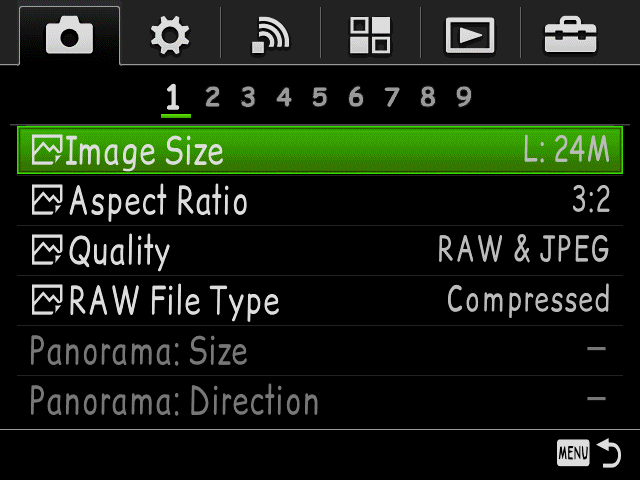
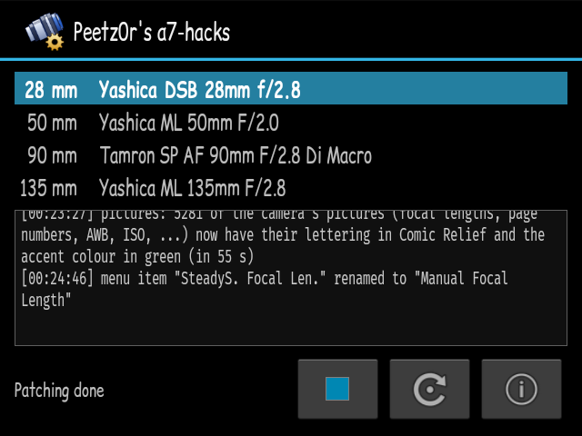
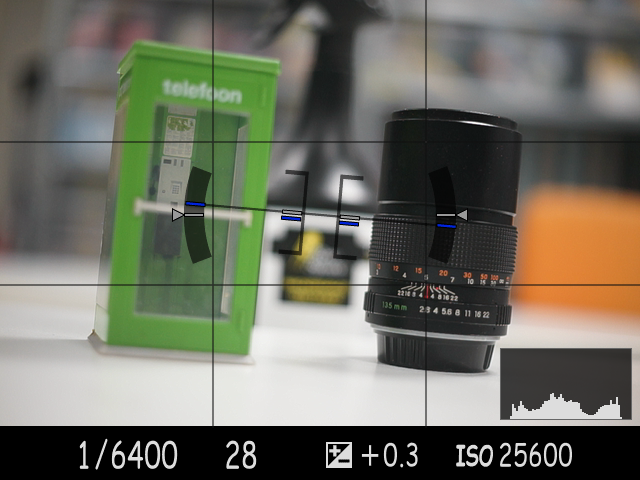
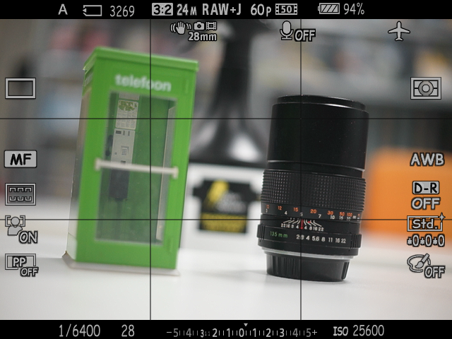

# α7 hacks

This is an app for my camera that makes it better (and adds some silly customisations).

My camera is a Sony α7 II, a full-frame mirrorless camera from 2014. It probably doesn't work on any other model or even firmware versions (I run 4.01) without modifications.

I got this camera used for relatively cheap, and I use it mostly with even cheaper vintage manual lenses. These contain no electronics. While they work very well, they leave the camera in a slightly degraded state. Occasionally I use newer lenses but on a dumb adapter, so that's effectively the same.

The built-in sensor stabilisation needs to know the lens' focal length to work properly. It usually does this automatically but with dumb lenses you can set this manually. I configured this setting to a custom button (C4) because I use it all the time. So far so good.

But that value isn't used for other things. Most notably, it doesn't write anything useful to the EXIF data so I can't find and organize my photos per lens. That's annoying. This prompted me to start this project, but while working on it I decided to do more.

When you use Aperture Priority mode with Auto-ISO, it should select a best shutter speed based on your lens' focal length and then use the ISO to make the exposure correct. But it stuck to 1/60th. Which made this mode near useless with longer lenses, and I had to use Manual (with Auto-ISO) in situations where I wanted Aperture priority.

## Improvements
* The sensor stabilisation setting is renamed to *Manual Focal Length* to make it look and feel more generic since we're using that setting for more purposes
* Feed that setting into the logic for the exposure calculations
* Display that setting in place of the (unknown) aperture on the live view
* Keep a list of lenses in a file on the SD card, and look up not just the focal length but also the name and widest aperture for that lens, and let the camera write that to the EXIF data.
* Fix the system clock. Sony has built their own clock driver, but they left the system clock at 1970-01-01 00:01:05 (yes, not exactly 00:00).
    + The system clock isn't used for anything, but it's nice to have it correct anyway.
* Screenshot tool for the native UI (CLI for now, separate OSD and Live view).
* 24h notation was only used with D-M-Y notation, is now also used with Y-M-D notation.
* Ships with a recent timezone database (tzdata 2026f) and allows you to upgrade by putting TZDATA.TGZ on the SD card
* Update the Level view to also have the Histogram on the same screen.
	+ [People have](https://www.dpreview.com/forums/threads/a7i-evf-with-both-histogram-and-level.4822662/) [been asking](https://www.reddit.com/r/SonyAlpha/comments/vx4vjy/comment/n5l3lb5/) [for this ](https://ca.community.sony.com/s/question/0D54O00006v8fOQSAY/sony-a7-series-incorporate-histogram-and-level-on-same-screen?language=en_US) [across many](https://www.reddit.com/r/SonyAlpha/comments/1hnrdmb/level_and_hist_on_displayevf_with_a6700/) [Sony Alpha](https://www.dpreview.com/forums/threads/showing-both-level-and-histogram-in-viewfinder-for-a6400.4430248/#post-63143887) [models for](https://www.dpreview.com/forums/threads/a6500-histogram-and-level-at-same-time.4115862/) [14 years](https://www.dpreview.com/forums/threads/no-level-and-histogram-at-the-same-time-nex7.3234071/)!


## Customisations
Warning: these are silly, but they can be disabled
* The UI font is now Comic Relief (a very close clone of Comic Sans)
* The accent color is now green instead of orange (yes I am considering vinyl wrapping the colored ring around the lens mount too)

## Screenshots

<p>
 
 
</p>

1. The first page of the menu with patched font and color
2. The app itself. Yes that's the Holo theme from Android 4.0
3. The view on the LCD with the level and histogram tool
4. The view on the EVF with all the settings and icons

## Configuration
Create a file `A7HACKS.INI` (the filename has to be all caps!) with the following contents on the SD card root:
```
[config]
font = on                         # menu font in Comic Relief; off: the camera's own (Univers)
icons = on                        # lettering in the icons and pictures in Comic Relief (needs font = on)
timezone = Europe/Amsterdam       # your timezone, if you want automatic DST functionality

[135]                             # focal length of the lens, this has to be a value available in the menu
model = Yashica ML 135mm f/2.8    # name of the lens as it should appear in the EXIF field LensModel
aperture = 2.8                    # widest aperture of the lens, appears in the EXIF field MaxApertureValue
```

All settings are optional, the `[config]` settings default to `on`. Values cannot contain `#` anywhere.

Note: you can't disable the color change separately from the icons.

## Installation

You'll need tools from the [PMCA-RE](https://github.com/ma1co/Sony-PMCA-RE/) project to install this app. See the [Usage chapter in their readme](https://github.com/ma1co/Sony-PMCA-RE#usage).

## Some background

The firmware of this camera is an embedded Linux 3.0.27 from 2014. It has published firmware updates until 2019, but all the components still date to around 2014. It comes with an Android 4.1.2 subsystem that allows users to install apps (made by Sony) to add some (mostly gimmicky) features. These are not that great.

Some of them end up re-creating the entire (native) camera UI as an android app, so you end up with a sliugtly worse (and notably slower) version with some missing features and added clunkyness. There is even an app that implented the EXIF writing for vintage lenses, but only when using the worse camera. I never used it beyond a single test.

Sony named it PlayMemories, and they [shut it down in 2024](https://www.sony.com/electronics/support/articles/00289030).

Luckily others have reverse engineered how to create and install apps way before that. Most notable is the [PMCA-RE](https://github.com/ma1co/Sony-PMCA-RE/) project. Their `pmca-console` tool can let you get a root shell, transfer files, install apps, etc. From that root shell you can obviously dump the entire flash and ram.

They also created their [Tweak](https://github.com/ma1co/OpenMemories-Tweak) app which can remove the 30 minute video limit, let you switch between PAL and NTSC framerates regardless of region (a very popular mod for *any* camera or any brand), and more.

Someone also [archived many of Sony's apps](https://archive.org/details/sony-playmemories-camera-apps), so you can still download and install them. Information about which version of which app works on which camera is a bit shoddy there, but just trying them is safe enough. Someone else even made it run [Doom](https://github.com/EfelerGibi/A6000-DOOM)!

The Tweak app comes with a [native library](https://github.com/ma1co/OpenMemories-Tweak/tree/master/app/src/main/jni) which we just borrow as [`libtweak.so`](app/src/main/jniLibs/armeabi/). It allows us to execute shell commands as root, including our own native binary. From there we basically own the entire camera firmware.

Our app does its things by patching code and data in memory, after startup. It doesn't overwrite any system files on flash. But it overwrites a few bits of code, a few strings, and many icons in ram. It takes a while, there is a progress bar.

It looks like a typical Android 4.x app with the Holo theme, and that's on purpose, to highlight the sillyness of an outdated android subsystem on an otherwise serious camera.

The regular camera UI is a native Linux app, running outside the android subsystem. Only when you enter the *Application List* in the menu, you actually enter Android.

The camera boots quite quickly and that is because it never does a cold boot but it loads an entire memory snapshot from a flash partition. That snapshot was taken 65 seconds after boot, so the camera's uptime will always be higher than that. The system clock is also set to that exact time after the unix epoch. Sony has created their own clock as a kernel driver, which they use for their UI and EXIF data, but isn't hooked up to the linux clock.

They also use a third party filesystem driver ([eSOL PrFILE2](https://www.esol.com/embedded/product/prfile2.html) inside fuse) for the SD card. This lets them use exFAT before Linux had a native exFAT driver. But that also gets the time directly from their clock driver, bypassing the Linux system clock entirely.

There is a glue layer between that driver and the rest of the system which adds some limitations. Filenames cannot be longer than 8.3, and they have to be all caps. It can list existing files with a lowercase filename but it cannot open them. This appears to be a bug, but you would usually not notice, since the camera only has to open files created by itself. If you believed fat32 was case-insensitive

## Licenses
* My work in this repository is licensed under the AGPL3, see [`License.md`](License.md)
* `libtweak.so` is [Copyright (c) 2016 ma1co](https://github.com/ma1co/OpenMemories-Tweak) and licenced under the MIT license
* The fonts are released under the SIL Open Font License, Version 1.1, see [`app/src/main/assets/fonts`](app/src/main/assets/fonts)
	* Comic Relief is [Copyright 2013 The Comic Relief Project Authors](https://github.com/loudifier/Comic-Relief)
	* Fira Mono is Copyright (c) 2012-2015, The Mozilla Foundation and Telefonica S.A.

## Full disclosure

This project was made with extensive help of an LLM. I don't like it, but I would not have been able to do all the reverse engineering and memory patching without any external help. This Readme is 100% human written.

I don't name them here because they don't need any more free advertising. Their company is not friend shaped. But I also don't want to hide anything and lie about what I did. That wouldn't work anyway.

Sony is also not friend shaped, this is also not an ad for them. Buy your camera and lenses used, and enjoy third party and vintage lenses. Some of my favourite lenses have been bought by my father in 1980 and are still amazing today!